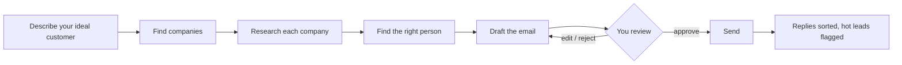

# Cadence

AI outreach with a human in the loop. Describe who you want to reach. Cadence finds the companies, researches each one, finds the right person, and drafts the first email. **Nothing is sent until you approve it.**

Built solo as a study of [Explee](https://explee.com) (an AI outreach agent), using only free tools.

<!--
  DEMO VIDEO
  1. Record the flow below (about 2 minutes).
  2. On GitHub, edit this file and drag the .mp4 (under 100 MB) into the editor. GitHub uploads it and
     inserts a link. Replace this comment with that link, or use a YouTube/Loom link.
-->
> **Demo video:** _add the link here_

---

## The flow



| Step | What happens | Where it lives |
|---|---|---|
| **Describe** | You write who you want to reach and what you sell. The AI turns it into a structured profile (industries, regions, roles, pain points, exclusions). | `services/icp.py` |
| **Find** | Web search (Tavily) returns candidate companies. Competitors are found separately and excluded from the leads. You can also import a CSV or add demo leads. | `services/discovery.py`, `competitors.py`, `seed.py` |
| **Research** | Each company's own website is fetched and read. The AI scores fit (0 to 100), summarises what the company does, and picks one specific detail to mention. | `services/research.py` |
| **Find people** | Names come only from the company's own About or Team pages. Published addresses are matched to people. Otherwise a `first.last@domain` guess is made and checked for a working mail server (DNS-over-HTTPS). Each address is labelled `found`, `guessed`, `role_address`, `no_mail_server` or `unknown`. | `services/people.py`, `dnscheck.py` |
| **Draft** | A short email is written from the research. Drafts with `[placeholders]` are rejected. The signature is added in code, not by the AI. Only leads with fit of 40 or more are drafted. | `services/drafting.py` |
| **Approve** | The approval queue shows each letter next to the facts it was built from. Edit, approve, reject, or redraft. | client `queue` page |
| **Send** | Approved emails are sent one at a time through the Mailtrap Email API. Each email is claimed (`approved` to `sent`) before the provider is called, so it can never go out twice. | `services/sending.py`, `email.py` |
| **Replies** | A reply is pasted in or simulated, then classified (interested, question, not interested, out of office, unsubscribe). Interested replies are flagged as hot. | `services/replies.py` |

Lead statuses: `new` → `researching` → `researched` / `no_data` → `drafted` → `approved` → `sent` → `replied` (or `failed`).
Email statuses: `draft` → `approved` → `sent` (or `failed`, `rejected`).

## Why the emails don't make things up

- The AI only extracts from text it fetched. A company name, domain or person that doesn't appear in the source text is dropped.
- Drafts are validated: right length, no placeholders, no unfilled template fields.
- Guessed addresses are never presented as verified.
- Every draft shows its source facts beside it in the approval queue.
- Model output is parsed as JSON and validated with Pydantic, with one retry.

## Safe sending (read this before deploying)

Sending is **off by default** for real recipients.

| Setting | Behaviour |
|---|---|
| `LIVE_SENDING=false` (default) | Every email is delivered **only to the signed-in account owner**, and only once their email is confirmed. The body starts with a `[Cadence demo]` note saying who it was drafted for. Leads are never contacted. |
| `DEMO_RECIPIENT=you@example.com` | Overrides the above: everything goes to this one inbox. |
| `LIVE_SENDING=true` | Emails go to the lead's real address. Use only with a sending domain you own and have verified. |

Mailtrap's free demo domain (`demomailtrap.co`) can only deliver to the Mailtrap account owner's address. To let other people receive their own demo emails, verify a domain in Mailtrap and use an address on it as `SENDER_EMAIL`.

## Stack

| Part | Tool |
|---|---|
| Frontend | Next.js 16 (App Router), React 19, Bun, TypeScript |
| Backend | FastAPI, Python 3.14, `uv`, Pydantic |
| Database and auth | Supabase (Postgres with row-level security, Supabase Auth) |
| LLM | Groq free plan, through an OpenAI-compatible client (`openai/gpt-oss-120b`, `openai/gpt-oss-20b`) |
| Web search | Tavily |
| Email | Mailtrap Email API |
| Hosting | Vercel (client), InstaCloud container (backend) |

The backend uses Supabase's service key, which bypasses row-level security, so **every query filters by `user_id`**. Long jobs (research, drafting, sending) run as FastAPI background tasks, and the client polls every 3 seconds. That is why the backend needs a long-running container, not serverless functions.

## Project layout

```
backend/
  app/
    main.py            FastAPI app and CORS
    auth.py            verifies the Supabase token
    config.py          settings from environment variables
    repo.py            all database access
    llm.py search.py   Groq client, Tavily client
    email.py           the only file that talks to the mail provider
    routers/           campaigns, emails, people, replies, me
    services/          icp, discovery, competitors, research, people, drafting, sending, replies, seed
  db/                  schema.sql, phase4.sql
  tests/               77 tests, all external services mocked
client/
  app/                 / (home), /login, and the signed-in app: dashboard, campaigns, leads, queue, replies
  components/          Pipeline, LeadTable, PeoplePanel, Mark, NavLinks
  lib/                 API client, Supabase client, types
```

## Run it locally

You need: [uv](https://docs.astral.sh/uv/), [Bun](https://bun.sh), and free accounts at Supabase, Groq, Tavily and Mailtrap.

**1. Database.** In the Supabase SQL editor, run `db/schema.sql`, then `backend/db/phase4.sql`. Under Authentication, keep email confirmation on.

**2. Backend.**

```bash
cd backend
cp .env.example .env        # fill in the values, see the table below
uv sync
uv run fastapi dev app/main.py
```

API at http://localhost:8000. Check `/health`, and `/docs` for the endpoints.

**3. Client.**

```bash
cd client
cp .env.example .env.local
bun install
bun dev
```

App at http://localhost:3000.

### Environment variables

Backend (`backend/.env`):

| Variable | Purpose |
|---|---|
| `SUPABASE_URL`, `SUPABASE_SERVICE_KEY` | Database. The service key is secret and stays on the server. |
| `CORS_ORIGINS` | Allowed frontend addresses, comma separated, no trailing slash. |
| `LLM_BASE_URL`, `LLM_API_KEY`, `LLM_MODEL`, `LLM_MODEL_FAST` | The language model. |
| `TAVILY_API_KEY` | Web search for finding companies. |
| `MAILTRAP_API_TOKEN`, `SENDER_EMAIL`, `SENDER_NAME` | Email provider and the sender shown on emails. |
| `DEMO_RECIPIENT`, `LIVE_SENDING` | Delivery rules, see "Safe sending". |

Client (`client/.env.local`):

| Variable | Purpose |
|---|---|
| `NEXT_PUBLIC_SUPABASE_URL`, `NEXT_PUBLIC_SUPABASE_ANON_KEY` | Browser-side Supabase. Use the anon key, never the service key. |
| `NEXT_PUBLIC_API_URL` | Backend address. Must start with `https://` in production. Baked in at build time, so redeploy after changing it. |

## Tests

```bash
cd backend
uv run pytest
```

77 tests cover the pipeline, the email state machine, the delivery rules and the anti-hallucination checks. The LLM, search, DNS and mail provider are mocked, so tests need no keys and make no network calls.

## Deploy

- **Client (Vercel):** import the repo, set Root Directory to `client`, add the three `NEXT_PUBLIC_*` variables for Production, deploy.
- **Backend (InstaCloud or any container host):** deploy the `backend` folder with its `Dockerfile`, add the backend variables, expose port 8000. Set `CORS_ORIGINS` to the exact Vercel address.
- **Supabase:** under Authentication, URL Configuration, set the Site URL and Redirect URLs to the Vercel address.
- Free container tiers can sleep when idle. Open `/health` before a demo to wake the backend.

## Known limits

- **No real inbound replies.** Replies are pasted in or simulated. Receiving them needs a domain with inbound mail routing.
- **Email finding is best effort.** Without a paid data provider, some leads have no verified address. Guesses are labelled as guesses.
- **Free-tier LLM.** Research is slower and rate-limited. The fit score is a model judgment, not a formula.
- **Background jobs are in-process.** If the server restarts mid-run, affected leads stay on "researching" until the step is run again.
- **Sending needs your own domain** to reach anyone other than the account owner (see "Safe sending").

## Roadmap

- Verified email data (a paid finder or verification API).
- Real inbound replies and threading.
- Meeting booking from interested replies.
- Learning from results: which hooks and subject lines get replies.
- A durable job queue instead of in-process background tasks.

## Credits

Study project inspired by [Explee](https://explee.com). Not affiliated with it.
